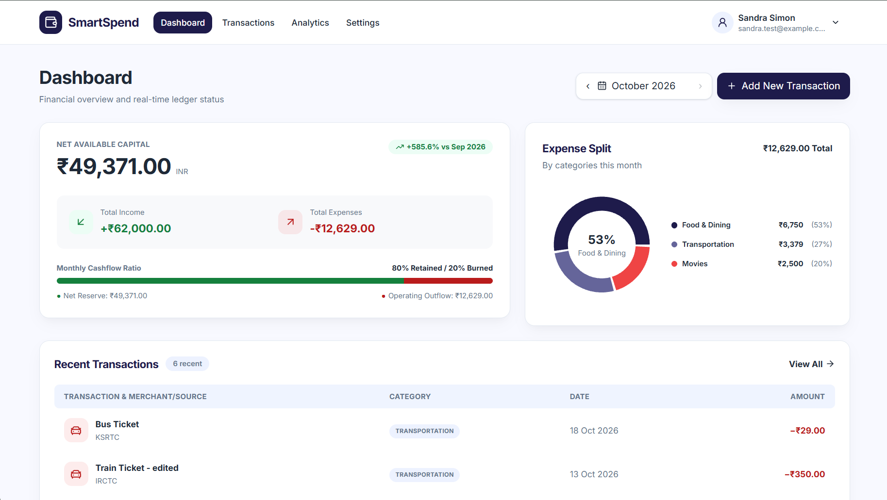
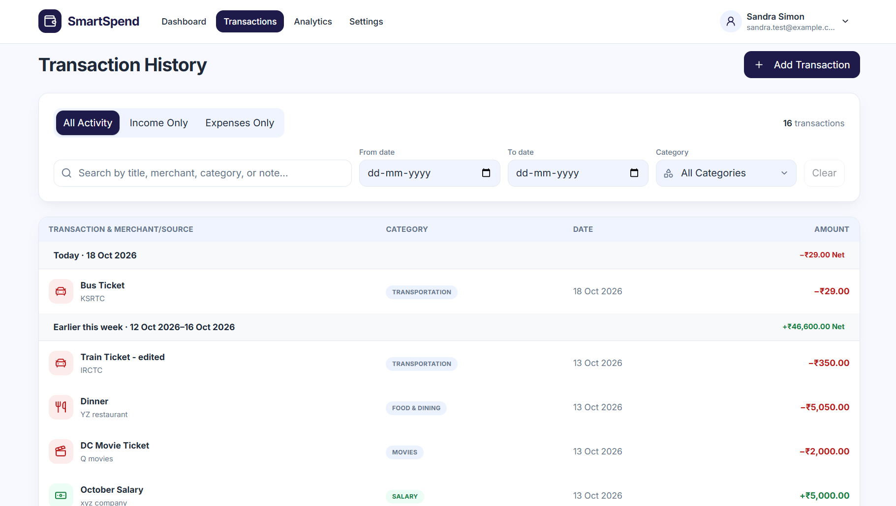
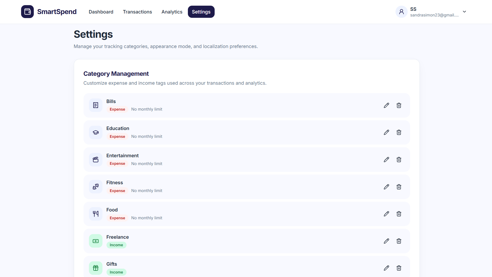
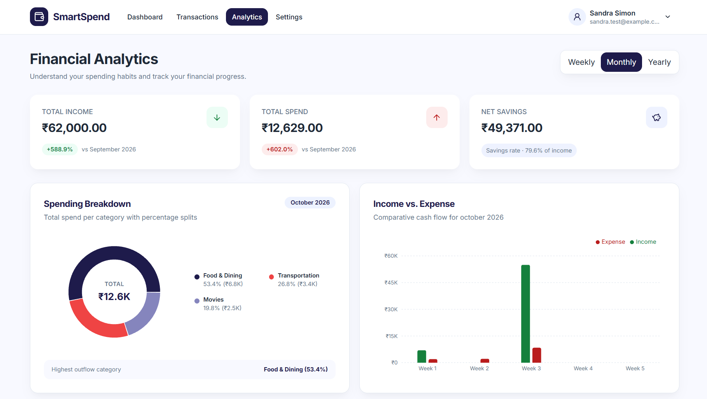

# SmartSpend - Personal Expense Tracker

**A full-stack web application for managing expenses, tracking budgets, and understanding spending habits through interactive analytics.**

SmartSpend helps users organize transactions, manage expense categories, monitor monthly budgets, and visualize their financial activity through an intuitive, responsive dashboard.

**Tech Stack:** React · TypeScript · FastAPI · PostgreSQL · Docker

---

## Screenshots

### Dashboard
View spending summaries, budget progress, and expense insights at a glance.



### Expense History
Track transactions with details such as date, category, amount, and description.



### Category Management
Organize expenses into categories and manage category-specific monthly limits.



### Analytics
Visualize spending patterns and compare expenses across different periods.



---

## Features

- **Expense Management** - Create, view, edit, and delete expense transactions.
- **Category Management** - Organize spending and configure monthly limits for categories.
- **Interactive Dashboard** - Review spending summaries, budget progress and expense breakdowns.
- **Financial Analytics** - Explore monthly spending trends and compare expenses across periods.
- **Authentication and Security** - Authenticated user operations and secure password hashing.
- **Profile Management** - Update profile information, preferences and password.
- **Responsive UI** - Access the application through a web browser on different screen sizes.
- **REST API Integration** - Connect the frontend to a dedicated backend service.

## Architecture

SmartSpend follows a separated frontend-backend architecture. The React frontend communicates with the FastAPI backend through REST APIs, while PostgreSQL stores application data.

```text
┌──────────────────────────────┐
│       React Frontend         │
│    TypeScript + Vite         │
└──────────────┬───────────────┘
               │
               │ REST API
               ▼
┌──────────────────────────────┐
│       FastAPI Backend        │
│ Authentication and Services  │
└──────────────┬───────────────┘
               │
               │ SQLAlchemy ORM
               ▼
┌──────────────────────────────┐
│          PostgreSQL          │
│       Persistent Data        │
└──────────────────────────────┘
```

## Tech Stack

| Layer | Technologies |
|---|---|
| Frontend | React, TypeScript, JavaScript, Vite |
| Backend | Python, FastAPI |
| Database | PostgreSQL |
| ORM and Migrations | SQLAlchemy, Alembic |
| Authentication | JWT, Argon2 password hashing |
| Containerization | Docker, Docker Compose |
| Continuous Integration | GitHub Actions |
| Version Control | Git, GitHub |

## Project Repositories

The frontend and backend are maintained in separate repositories.

- **Frontend:** [SmartSpend Frontend](https://github.com/sandra-simon/smartspend-frontend)
- **Backend:** [SmartSpend Backend](https://github.com/sandra-simon/smartspend-backend)

## Run Locally

SmartSpend currently runs locally and does not have a hosted live demo.

### Prerequisites

- Node.js and npm
- Python
- PostgreSQL
- Git

Docker can also be used for the backend environment where configured.

### 1. Clone the repositories

```bash
git clone https://github.com/sandra-simon/smartspend-frontend.git
git clone https://github.com/sandra-simon/smartspend-backend.git
```

### 2. Start the backend

Follow the backend repository's README for dependency installation, environment configuration, database setup, and startup instructions.

### 3. Configure and start the frontend

From the frontend directory, install dependencies:

```bash
npm install
```

Create a local `.env` file and configure the backend API URL:

```env
VITE_API_BASE_URL=http://localhost:8000/api/v1
```

Start the development server:

```bash
npm run dev
```

Open the local URL printed in the terminal.

## Engineering Practices

- Modular frontend components and service-based API integration.
- RESTful API design and request validation.
- Environment-based application configuration.
- Database schema migrations with Alembic.
- Docker-based backend and database development setup.
- GitHub Actions workflow for continuous integration.

## Author

**Sandra Simon**

- [GitHub](https://github.com/sandra-simon)
- [LinkedIn](https://www.linkedin.com/in/sandra-simon2301/)